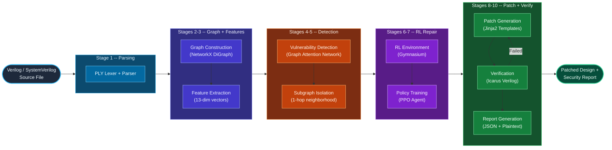
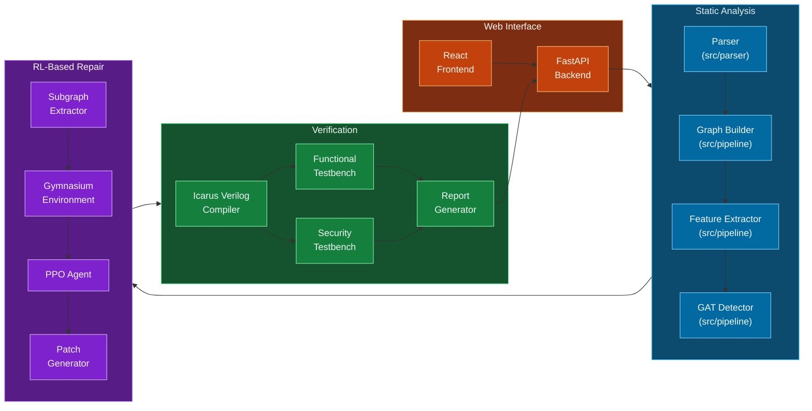
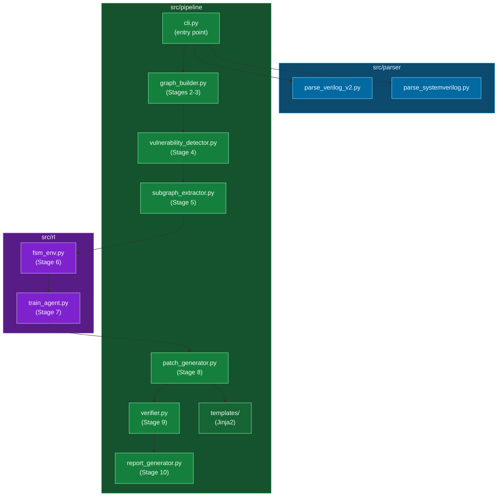

# FSMGuard

**Automated security vulnerability detection and patching for Finite State Machine (FSM) hardware designs using Graph Neural Networks and Reinforcement Learning.**

FSMGuard analyzes FSMs in Verilog and SystemVerilog designs, identifies security weaknesses such as unprotected transitions, dead-end states, and privilege escalation paths, and generates verified patches that fix vulnerabilities while preserving functional correctness.

---

## Table of Contents

- [How It Works](#how-it-works)
- [Architecture](#architecture)
- [Project Structure](#project-structure)
- [Prerequisites](#prerequisites)
- [Installation](#installation)
- [Usage](#usage)
- [Web Interface](#web-interface)
- [Results](#results)
- [Documentation](#documentation)
- [License](#license)

---

## How It Works

FSMGuard operates as a ten-stage pipeline that takes a Verilog or SystemVerilog source file as input and produces a patched, verified design as output.

| Stage | Name | Description |
|-------|------|-------------|
| 1 | **Parsing** | Parses Verilog/SystemVerilog source files to extract FSM structures (states, transitions, control logic) using a custom PLY-based parser. |
| 2 | **Graph Construction** | Converts the extracted FSM into a directed graph using NetworkX, where nodes represent states and edges represent transitions. |
| 3 | **Feature Extraction** | Computes a 13-dimensional feature vector per state covering structural properties (in/out degree, self-loops, reset distance) and CWE-based security indicators (auth bypass, privilege escalation). |
| 4 | **Vulnerability Detection** | A Graph Attention Network (GAT) classifies each state as safe or vulnerable based on its feature vector and neighborhood context. Produces CWE-mapped severity scores. |
| 5 | **Subgraph Isolation** | Extracts the 1-hop neighborhood around each vulnerable state to focus the repair process on affected regions. |
| 6 | **RL Environment** | A Gymnasium environment simulates FSM modifications. The observation space encodes the current vulnerability context; the action space covers fix categories, parameters, and strictness levels. |
| 7 | **Policy Training** | A PPO agent (Stable-Baselines3) learns to select optimal security fixes through interaction with the environment over 200K training timesteps. |
| 8 | **Patch Generation** | Applies the selected fixes using Jinja2 templates to produce patched Verilog code. Supported fix types: transition guards, state pruning, state re-encoding, and deadlock prevention. |
| 9 | **Verification** | Compiles the patched design with Icarus Verilog and runs generated testbenches to verify functional correctness and absence of introduced security violations. |
| 10 | **Reporting** | Generates a comprehensive JSON and plaintext report covering all detected vulnerabilities, applied fixes, and verification results. |

---

## Architecture

### Pipeline Flow



### System Architecture



### Component Mapping



---

## Project Structure

```
FSMGuard/
|-- README.md
|-- .gitignore
|
|-- src/                        # Core source code
|   |-- parser/                 # Stage 1: Verilog/SystemVerilog parsers
|   |   |-- parse_verilog.py
|   |   |-- parse_verilog_v2.py
|   |   +-- parse_systemverilog.py
|   |
|   |-- pipeline/               # Stages 2-10: Analysis and patching pipeline
|   |   |-- cli.py              # Command-line entry point
|   |   |-- graph_builder.py    # Stages 2-3: Graph construction and features
|   |   |-- vulnerability_detector.py  # Stage 4: GAT-based detection
|   |   |-- subgraph_extractor.py      # Stage 5: Subgraph isolation
|   |   |-- patch_generator.py  # Stage 8: Jinja2-based patch generation
|   |   |-- sv_converter.py     # SystemVerilog to Verilog converter
|   |   |-- verifier.py         # Stage 9: Icarus Verilog verification
|   |   |-- report_generator.py # Stage 10: Report generation
|   |   +-- templates/          # Jinja2 patch templates
|   |       |-- guard.j2
|   |       |-- prune.j2
|   |       |-- reencode.j2
|   |       +-- deadlock.j2
|   |
|   +-- rl/                     # Stage 6-7: Reinforcement learning
|       |-- fsm_env.py          # Gymnasium environment
|       |-- fsm_graph.py        # Graph utilities for RL
|       +-- train_agent.py      # PPO training script
|
|-- backend/                    # FastAPI web backend
|   |-- api.py                  # REST API endpoints
|   |-- pipeline_runner.py      # Pipeline execution engine
|   |-- requirements.txt
|   +-- start_server.sh
|
|-- frontend/                   # React + TypeScript web UI
|   |-- src/
|   +-- package.json
|
|-- tests/                      # Test suite
|   |-- test_full_pipeline.py   # End-to-end integration tests
|   |-- test_stage8.py          # Patch generation tests
|   |-- test_network_fsm.py     # Network FSM test case
|   |-- test_training.py        # Training smoke test
|   |-- test_env_formats.py     # RL environment format tests
|   |-- test_api.py             # Backend API tests
|   |-- validate_env.py         # RL environment validation
|   |-- validate_pipeline.py    # Pipeline validation
|   +-- verify_sb3.py           # Stable-Baselines3 compatibility check
|
|-- scripts/                    # Utility and analysis scripts
|   |-- run_stages_5_10.py      # Run stages 5-10 from saved stage 4 output
|   |-- train_20k.py            # Quick 20K-step training run
|   |-- demo_env.py             # RL environment demo
|   |-- demo_training.py        # Training demo
|   |-- analyze_detection.py    # Detection accuracy analysis
|   +-- analyze_fix_accuracy.py # Fix accuracy analysis
|
|-- models/                     # Trained model weights (not tracked in git)
|   |-- fsm_gat_best.pth        # Best GAT model checkpoint
|   |-- fsm_gat_model.pth       # GAT model checkpoint
|   |-- fsm_ppo_best.zip        # Best PPO agent
|   |-- fsm_ppo_20k.zip         # PPO agent (20K steps)
|   +-- fsm_ppo_agent.zip       # PPO agent checkpoint
|
|-- examples/                   # Example Verilog/SystemVerilog designs
|   |-- sample_fsm.v
|   |-- vulnerable_fsm.v
|   |-- network_fsm.v
|   |-- test_fsm.v
|   |-- dma_timing_control.sv
|   |-- dma_timing_control_verilog.v
|   +-- systemverilog_fsm.sv
|
+-- docs/                       # Additional documentation
    |-- changelog.md
    |-- patch_generation.md
    |-- stage07_ppo_training.md
    |-- stage08_patch_execution.md
    |-- systemverilog_support.md
    +-- test_results.md
```

---

## Prerequisites

- Python 3.9 or later
- Node.js 18 or later (for the frontend)
- Icarus Verilog (`iverilog`) for design verification

### Python Dependencies

| Package | Purpose |
|---------|---------|
| torch | PyTorch for the GAT neural network |
| torch-geometric | Graph neural network layers |
| networkx | FSM graph construction |
| stable-baselines3 | PPO reinforcement learning agent |
| gymnasium | RL environment interface |
| jinja2 | Patch template rendering |
| ply | Verilog/SystemVerilog lexer and parser |
| numpy | Numerical computation |

---

## Installation

### 1. Clone the repository

```bash
git clone https://github.com/your-org/FSMGuard.git
cd FSMGuard
```

### 2. Set up a Python virtual environment

```bash
python3 -m venv venv
source venv/bin/activate
```

### 3. Install Python dependencies

```bash
pip install torch torch-geometric networkx stable-baselines3 gymnasium jinja2 ply numpy
```

### 4. Install Icarus Verilog (for verification)

```bash
# macOS
brew install icarus-verilog

# Ubuntu / Debian
sudo apt-get install iverilog
```

### 5. (Optional) Set up the web interface

```bash
# Backend
pip install -r backend/requirements.txt

# Frontend
cd frontend
npm install
```

---

## Usage

### Command-Line Analysis

Run the full pipeline on a Verilog or SystemVerilog file:

```bash
python src/pipeline/cli.py examples/vulnerable_fsm.v --verbose
```

Options:

| Flag | Description |
|------|-------------|
| `--output-dir DIR` | Output directory for results (default: `./output`) |
| `--force-sv` | Force SystemVerilog parsing mode |
| `--force-verilog` | Force standard Verilog parsing mode |
| `--verbose` | Enable detailed stage-by-stage output |

The process exits with code `0` if no vulnerabilities are found, or `2` if vulnerabilities were detected.

### Run Stages 5-10 Separately

If you have already generated stage 1-4 outputs, you can run the remaining stages independently:

```bash
python scripts/run_stages_5_10.py
```

### Train the RL Agent

Full training (200K timesteps):

```bash
python src/rl/train_agent.py
```

Quick training (20K timesteps):

```bash
python scripts/train_20k.py
```

### Run Tests

```bash
python -m pytest tests/
```

---

## Web Interface

FSMGuard includes a full-stack web application for interactive analysis.

### Start the backend

```bash
cd backend
./start_server.sh
# or: uvicorn api:app --reload --port 8000
```

### Start the frontend

```bash
cd frontend
npm run dev
```

### API Endpoints

| Method | Endpoint | Description |
|--------|----------|-------------|
| POST | `/api/upload` | Upload a Verilog/SystemVerilog file |
| POST | `/api/analyze/{job_id}` | Start pipeline analysis |
| GET | `/api/status/{job_id}` | Check job progress |
| GET | `/api/results/{job_id}` | Retrieve analysis results |
| GET | `/api/download/patched/{job_id}` | Download patched design |
| GET | `/api/download/report/{job_id}` | Download security report |
| DELETE | `/api/job/{job_id}` | Clean up job workspace |

---

## Results

FSMGuard has been validated on a 12-test suite covering a range of FSM vulnerability types.

| Metric | Value |
|--------|-------|
| Vulnerability detection rate | 100% |
| Fix accuracy | 83.3% |
| Verification pass rate | 100% (for applied fixes) |

Detected vulnerability classes include unprotected state transitions, dead-end states, missing authentication checks, privilege escalation paths, and unsafe reset behavior.

For detailed test results, see [docs/test_results.md](docs/test_results.md).

---

## Documentation

| Document | Description |
|----------|-------------|
| [docs/changelog.md](docs/changelog.md) | Implementation history and change log |
| [docs/patch_generation.md](docs/patch_generation.md) | Patch generation system design |
| [docs/stage07_ppo_training.md](docs/stage07_ppo_training.md) | PPO training configuration and hyperparameters |
| [docs/stage08_patch_execution.md](docs/stage08_patch_execution.md) | Patch execution and template system |
| [docs/systemverilog_support.md](docs/systemverilog_support.md) | SystemVerilog parsing capabilities |
| [docs/test_results.md](docs/test_results.md) | Detailed test results and benchmarks |
| [backend/README.md](backend/README.md) | Backend API documentation |

---

## License

This project is provided for academic and research purposes.
